  

  Formado em <b>Análise e Desenvolvimento de Sistemas</b> pela FIAP. Construo back-end em <b>TypeScript</b> e <b>Node.js</b>:
  APIs multi-tenant, bots e integrações entre plataformas, com foco em arquitetura limpa, segurança
  e código que aguenta manutenção.

### `span 01` · stack

  

### `span 02` · projetos

  

  

  

### `span 03` · response

  

  <a href="mailto:arandas.dev@gmail.com">arandas.dev@gmail.com</a>
  &nbsp;·&nbsp;
  <a href="https://www.linkedin.com/in/arandasdev/">LinkedIn</a>

